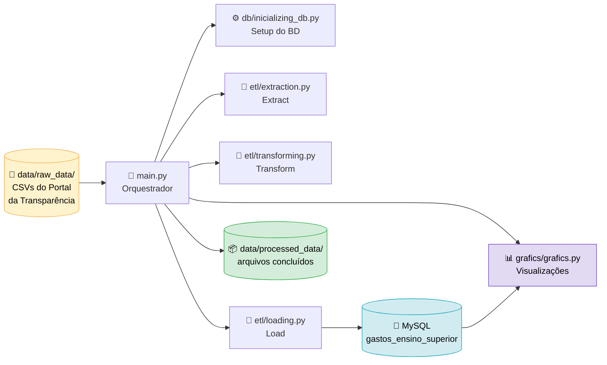

<div align="center">

# 🎓 GovEdu Data Flow

### Pipeline ETL automatizado para os gastos federais com Ensino Superior no Brasil

*Extrai, limpa, agrega e carrega dados do Portal da Transparência em um banco MySQL e gera visualizações gráficas a partir deles.*

<br>


<br>

[📌 Sobre](#-sobre-o-projeto) •
[🔄 Fluxo](#-fluxo-do-pipeline) •
[⚙️ Processos](#️-o-que-cada-etapa-faz) •
[📊 Visualizações](#-visualizações--graficsgraficspy) •
[📂 Estrutura](#-estrutura-do-repositório) •
[🚀 Como usar](#-como-executar) •
[👤 Autor](#-autor)

</div>

---

## 📌 Sobre o projeto

O **GovEdu Data Flow** transforma os arquivos CSV de despesas públicas do [Portal da Transparência](https://portaldatransparencia.gov.br/) em uma base estruturada e consultável, focada em **gastos federais com Ensino Superior**, e permite explorar esses dados por meio de **gráficos gerados diretamente a partir do banco**.

Os arquivos brutos são grandes, usam codificação `latin-1`, separador `;` e valores monetários com vírgula decimal. O pipeline resolve tudo isso de forma automática:

- ✅ Lê somente as colunas relevantes
- ✅ Filtra apenas a subfunção **Ensino superior**
- ✅ Converte valores monetários para numérico
- ✅ Calcula indicadores de execução orçamentária
- ✅ Agrega os registros e carrega no **MySQL**
- ✅ Organiza os arquivos já processados para preservar o histórico
- ✅ Gera visualizações gráficas a partir dos dados carregados, por meio de um menu interativo no terminal

---

## 🔄 Fluxo do pipeline



O orquestrador é o `main.py`: ele percorre todos os CSVs de `data/raw_data/`, executa as três etapas em sequência, move cada arquivo concluído para `data/processed_data/` e, ao final, oferece a visualização de gráficos com os dados já armazenados no banco.


---

## ⚙️ O que cada etapa faz

### 0️⃣ Setup — `db/initializing_db.py`

| Ação | Detalhe | 
| ----- | ----- | 
| Leitura SQL | Lê o script estrutural `db/sql/creation_db.sql` | 
| Conexão | Cria a *engine* de comunicação com o banco MySQL via SQLAlchemy | 
| Inicialização | Automatiza a criação do banco de dados e da tabela alvo antes do processamento dos dados | 

### 1️⃣ Extract — `etl/extraction.py`

| Ação | Detalhe | 
| ----- | ----- | 
| Leitura | `pd.read_csv` com `sep=';'` e `encoding='latin-1'` | 
| Seleção | Carrega apenas as colunas necessárias (`usecols`) | 
| Padronização | Padroniza a nomenclatura das colunas originais adotando o formato `snake_case` | 
| Filtro | Mantém somente `nome_subfuncao == 'Ensino superior'` | 
| Limpeza | Remove linhas com valores nulos (`dropna`) | 

### 2️⃣ Transform — `etl/transforming.py`

| Ação | Detalhe | 
| ----- | ----- | 
| Conversão de tipos | Valores monetários de texto com vírgula para `float` | 
| Novo campo `valor_abatido` | `valor_pago + valor_liquidado + valor_restos_a_pagar_cancelado` | 
| Novo campo `restos_a_pagar` | `valor_empenhado - valor_abatido` | 
| Enxugamento | Descarta as colunas intermediárias que não serão mais usadas | 
| Agregação | `groupby` por período, órgão, unidade, programa, ação, localizador, categoria e grupo de despesa, somando `valor_empenhado`, `valor_abatido` e `restos_a_pagar` | 
| Ordenação | Resultado ordenado por `nome_orgao_subordinado` | 

### 3️⃣ Load — `etl/loading.py`

| Ação | Detalhe | 
| ----- | ----- | 
| Destino | Tabela `gastos_ensino_superior` | 
| Modo | `if_exists='append'`, preservando o histórico já carregado | 
| Performance | Inserção em lotes (`chunksize=1000`) | 
| Retorno | Quantidade de linhas enviadas ao banco | 

### 📊 Visualizações — `grafics/grafics.py`

Depois da carga, os dados já estão no MySQL e podem ser explorados visualmente. Cada gráfico é uma função que recebe a *engine* de conexão, consulta a tabela `gastos_ensino_superior` com uma query SQL, monta um `DataFrame` e o exibe com **Seaborn** e **Matplotlib**.

| Gráfico | Função | O que mostra | 
| ----- | ----- | ----- | 
| 1️⃣ Faculdades que mais empenharam valor | `grafico_maiores_valores_empenhado` | Compara `valor_empenhado`, `valor_abatido` e `restos_a_pagar` das cinco faculdades com maior valor empenhado | 
| 2️⃣ Gastos da UFABC mês a mês | `visualizacao_mes_mes_ufabc` | Evolução mensal do valor empenhado, do valor abatido e do acumulado de restos a pagar da Fundação Universidade Federal do ABC | 
| 3️⃣ Registros mensais da UFABC | `registros_mensais_ufabc` | Quantidade de registros (compras) da UFABC em cada mês | 

Características em comum entre os gráficos:

- 📐 Os dados são reorganizados com `pd.melt` para que cada tipo de valor vire uma barra no gráfico agrupado
- 🎨 Paleta de cores padronizada e grade horizontal tracejada para facilitar a leitura
- 🔁 O módulo contém apenas funções, sem execução ao ser importado, e é consumido pelo `main.py`

### 🎛️ Orquestração — `main.py`

1. **Inicializa o banco de dados**: Aciona o módulo `db/initializing_db.py` para ler o arquivo SQL, automatizar a criação do banco e gerar a *engine* de conexão necessária para a carga.
2. **Busca de arquivos**: Percorre todos os arquivos `.csv` localizados no diretório `data/raw_data/`.
3. **Execução do ETL**: Aplica o ciclo completo de **extração → transformação → carga** individualmente para cada arquivo encontrado.
4. **Organização**: Move automaticamente o arquivo processado com sucesso para a pasta `data/processed_data/`.
5. **Tratamento de falhas**: Se ocorrer falha em um arquivo específico, ele **permanece em `data/raw_data/`** e o erro é reportado no terminal, sem interromper o processamento dos demais arquivos.
6. **Resumo**: Exibe ao término da execução o total de linhas que foram enviadas com sucesso para o banco de dados.
7. **Visualizações**: Pergunta se o usuário deseja ver os gráficos. Em caso positivo, lista as opções disponíveis, exibe o gráfico escolhido e permite consultar quantos outros quiser, até que o usuário decida encerrar.
---

## 📂 Estrutura do repositório

```
GovEdu_Data_Flow/
├── data/                      # Diretório central de dados
│   ├── processed_data/        # CSVs já carregados no banco
│   └── raw_data/              # CSVs brutos aguardando processamento
├── db/                        # Infraestrutura e inicialização do banco
│   ├── sql/                   # Armazena todas as queries SQL do projeto
│   │   ├── creation_db.sql    # Script de criação do banco/tabela
│   │   ├── ufabc_queries.sql  # Queries de consulta voltadas a UFABC
│   │   └── queries.sql        # Queries de consulta do cenário geral
│   ├── __init__.py            # Torna o diretório db um pacote importável
│   └── initializing_db.py     # Leitura do SQL e criação da engine
├── etl/                       # Scripts do pipeline de dados
│   ├── __init__.py            # Torna o diretório etl um pacote importável
│   ├── extraction.py          # Etapa de extração
│   ├── loading.py             # Etapa de carga
│   └── transforming.py        # Etapa de transformação
├── grafics/                   # Visualizações gráficas dos dados
│   ├── __init__.py            # Torna o diretório grafics um pacote importável
│   └── grafics.py             # Funções que consultam o banco e geram os gráficos
├── .env.example               # Modelo de variáveis de ambiente
├── .gitignore                 # Arquivos ignorados pelo controle de versão do Git
├── main.py                    # Orquestrador do pipeline e menu de visualizações
├── README.md                  # Arquivo principal de documentação do projeto
└── requirements.txt           # Lista de dependências e bibliotecas do projeto
```

---

## 🚀 Como executar

### Pré-requisitos
- Python 3.9+
- MySQL em execução
- Ambiente com interface gráfica, para que as janelas dos gráficos possam ser exibidas

### Passo a passo

```bash
git clone https://github.com/joaoalexds/GovEdu_Data_Flow.git
cd GovEdu_Data_Flow

python -m venv venv
source venv/bin/activate  # (Windows: venv\Scripts\activate)
pip install -r requirements.txt

cp .env.example .env      # Preencha as credenciais no .env

# Adicione os CSVs na pasta raw_data/ e inicie:
python main.py
```

### Saída esperada

```text
--------------------------------------------------
O processo foi concluído!
Foram passadas um total de N linhas a DB
--------------------------------------------------
Deseja visualizar os gráficos referentes à base de dados? (1 - Sim | 0 - Não):
```

Ao responder `1`, o menu de gráficos é exibido:

```text
--------------------------------------------------
Qual dos gráficos você deseja ver?
1 - Faculdades que mais empenharam valor
2 - Visualização dos gastos da UFABC mês a mês
3 - Quantos registros (compras) a UFABC
Digite o número do gráfico que deseja ver:
```

Após cada gráfico, o terminal pergunta se você deseja visualizar mais algum.

---

## 🛠️ Tecnologias e Bibliotecas

| Tecnologia/Biblioteca | Uso no projeto | 
| ----- | ----- | 
| **Python** | Linguagem principal do pipeline de dados | 
| **Pandas** | Leitura dos CSVs, seleção, limpeza, conversão de tipos, cálculo e agregação estruturada dos dados, além da montagem dos DataFrames usados nos gráficos | 
| **SQLAlchemy** | Toolkit SQL e ORM utilizado para criar a camada de conexão (*engine*) e facilitar a inserção de DataFrames no banco | 
| **PyMySQL** | Driver de conexão em Python que permite a comunicação direta e a execução de comandos no servidor MySQL | 
| **python-dotenv** | Leitura e carregamento seguro das variáveis de ambiente e credenciais de banco a partir do arquivo `.env` | 
| **Matplotlib** | Criação das figuras, eixos, grades e exibição dos gráficos | 
| **Seaborn** | Geração dos gráficos de barras (`barplot`) com paleta de cores personalizada | 
| **os / shutil** | Bibliotecas nativas do Python utilizadas na orquestração para mapear os diretórios e mover os arquivos processados | 
| **SQL** | Linguagem utilizada no arquivo `creation_db.sql`, `queries.sql` e `ufabc_queries.sql` para definir a estrutura (DDL) de criação do banco e da tabela, além de realizar consultas nos dados, incluindo as queries que alimentam os gráficos | 
| **MySQL** | Banco de dados relacional (SGBD) de destino final, garantindo armazenamento estruturado e manutenção do histórico | 

---

## 👤 Autor

<div align="center">

**João Alexandre V. Bernardo**

[](https://www.linkedin.com/in/joaoalexandrevb/)
[](https://github.com/joaoalexds)

*Gostou do projeto? Deixe uma ⭐ e vamos nos conectar no LinkedIn!*

</div>
